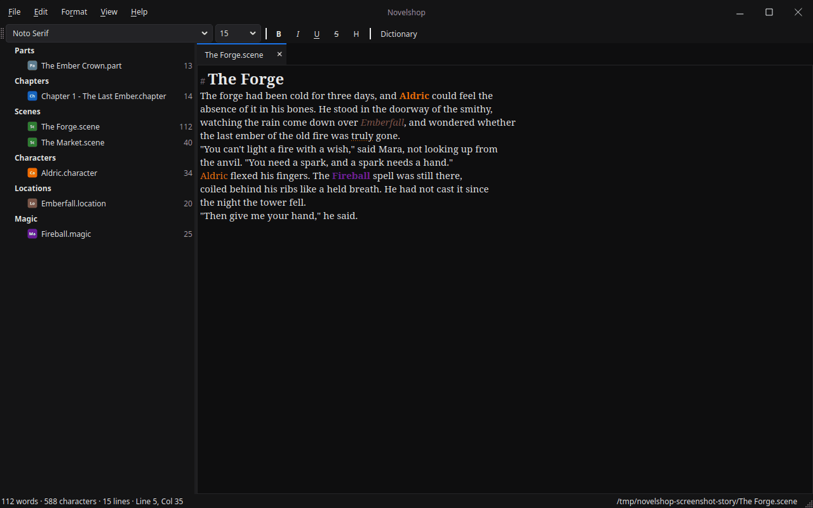

# Novelshop

A plain, focused writing app in Python + PySide6 (Qt). File tree, editor,
word count, autosave — in its own light or dark theme, with a native
window frame.

## How to run it

1. Install Python 3.14 (or newer).
2. Install the dependencies: `pip install -r requirements.txt`
3. Run `main.py`.

### Piper voice (for the neural Read Aloud voice)

To use the Piper voice, two one-time steps. `piper-tts` is in `requirements.txt`, so this is just the voice itself:

1. Download a voice — two files, the model and its config. For
   example, lessac (a natural-sounding American voice):
   `en_US-lessac-medium.onnx` and `en_US-lessac-medium.onnx.json`,
   from <https://huggingface.co/rhasspy/piper-voices/tree/main/en/en_US/lessac/medium>.
   Put them together in a folder (they are about 63MB).
2. In the app: View → Read Aloud Voice → Piper (neural), then
   Choose Piper voice file... and pick the `.onnx`. The app remembers
   the voice.

## What it does

- **Open Folder** (Ctrl+Shift+O) — the file tree on the left lists the
  folder's files. Click one to open it.
- **Editor** — write in the main pane. Word, character, and line counts
  plus line/column live in the status bar.
- **Save** (Ctrl+S) / **Save As** (Ctrl+Shift+S) / **New** (Ctrl+N) /
  **Open File** (Ctrl+O).
- **Autosave** — 2 seconds after you stop typing, the document saves
  to its file. Autosave starts once the document has been saved to a
  file.
- **Dirty tracking** — a `*` in the title marks unsaved changes, and
  a Save / Don't save / Cancel prompt appears before New, Open, or
  Quit when there are unsaved changes.
- **Look** — the app has its own light and dark themes and a native
  window frame. The editor font (Georgia 15px) is set on the editor
  itself.
- **Tabs** — each document opens in its own tab. Clicking a file that's
  already open switches to its tab. Close a tab with its × button or
  Ctrl+W; dirty tabs ask before closing.
- **Binder** — the file tree starts empty. Open a folder (Ctrl+Shift+O)
  and its files appear grouped under section headers that exist
  when files of that type are in the folder: Parts (`.part`), Chapters
  (`.chapter`), Scenes (`.scene`), Drafts (`.draft`), Plot (`.plot`),
  Outlines (`.outline`), Characters (`.character`), Locations
  (`.location`), Languages (`.language`), Cultures (`.culture`),
  Factions (`.faction`), Species (`.species`), Magic (`.magic`), Items
  (`.item`), Timelines (`.timeline`), Glossaries (`.glossary`),
  Research (`.research`), Notes (`.note`), and Documents (`.txt`,
  `.md`). Any other extension works too: a `.spell` file gets its own
  "Spell" section. Every file is plain text; the extension is what
  categorizes it. Files stay where they are on disk; the tree groups
  them for display. Headers are spacers with bold text, and each section
  collapses with its arrow; sections open
  expanded by default, and one you closed by hand stays closed. Each
  file has a badge icon: a colored square with two letters for its
  type (Ch for chapter, Sc for scene, Ca for character), and a custom
  extension gets a grey badge from its own letters. File → New File...
  opens a window where you name the file and pick its type from a
  dropdown (Custom is an option there). The folder picker lists the
  folder's text files.
- **Rename** — right-click a file in the tree (or press F2 with it
  selected) to rename it, name and type. The window is pre-filled
  with what the file is now; change the name, or pick a different
  type from the dropdown. Rename checks that the new name is
  available and valid for Windows. Changing the type moves the
  file to that section — a `.txt` note becomes a `.plot`, a `.draft`
  becomes a `.chapter` — and if the file is open in a tab, the tab
  follows it to the new name, unsaved changes included. Snapshots
  are timestamp-named in the folder's `.snapshots`.
- **Trash** — right-click a file in the tree (or press Delete with it
  selected) to move it to a `.trash` folder inside the project, where
  it shows up under a Trash section at the bottom of the tree.
  Deleting is one click, and the file stays recoverable until you
  empty the Trash. A file deleted twice, or restored over an existing
  file, gets a number ("Chapter 1 2.chapter"), keeping both files.
  Right-click a trashed file to Restore it, or Delete Permanently;
  right-click the Trash header to Empty Trash. Permanent deletes ask
  first. If the file is open in a tab, the tab closes first, and a
  dirty tab asks to save so the trashed copy is up to date. The Trash
  folder travels with the project, and it is hidden from the tree
  like any other dot-folder.
- **Find & replace** — Ctrl+F opens a Find bar under the tabs (Ctrl+H
  jumps straight to the Replace field). Find Next/Previous wrap around
  the document, Replace acts on the current match, Replace All reports
  how many it replaced, Aa toggles case sensitivity, Esc closes the bar.
  It searches the tab you're looking at.
- **Snapshots** — File → Take Snapshot (Ctrl+Shift+T) saves a dated
  backup of the current document in a `.snapshots` folder next to it.
  File → Snapshots... lists them newest first; Restore loads one back
  into the editor as unsaved changes (Ctrl+Z undoes it; save to keep
  it), Delete removes it. **Compare** shows what changed: select two
  snapshots to diff them, or one to diff it against the current
  document — added lines in green, removed in red.
- **Quick Open** — File → Quick Open... (Ctrl+P) jumps to any file in
  the folder by typing its name. Type a few letters and the list
  narrows; Enter or a double-click opens the file.
- **Session restore** — on quit it remembers the open folder and all
  open files, and reopens them on launch, so you pick up where you
  left off. To start, open a folder (Ctrl+Shift+O, which starts in
  Documents).
- **Export** — File → Export... (Ctrl+E) turns the folder into a
  finished manuscript: DOCX (Word), EPUB (ebook), or PDF. It stitches
  the files together in tree order, each file's name becoming its
  heading, parts and chapters starting on a new page. Parts, chapters,
  and scenes are ticked by default; tick in character sheets, notes,
  and other reference files to include them. Title defaults to the
  folder name; author is optional. Unsaved changes are saved first,
  so the export includes the latest text. DOCX needs python-docx,
  EPUB needs ebooklib (both in `requirements.txt`); PDF uses Qt's own
  printing.
- **Rich text** — the editor reads and writes Markdown, so the files
  stay plain text: `**bold**`, `*italic*`, `<u>underlined</u>`,
  `~~struck~~`, and `==highlighted==` in the file, rendered formatted
  in the editor. Bold (Ctrl+B), Italic (Ctrl+I), Underline (Ctrl+U),
  Strikethrough (Ctrl+Shift+X), and Highlight (Ctrl+Shift+H, pale
  yellow, for passages to come back to) buttons sit in the formatting
  toolbar, and they apply to whatever is selected; clicking a button
  again turns its formatting off. Ctrl+Space takes the selection
  back to plain text in one go. The toolbar also has the font picker
  and size: that's the writing font for the whole editor, remembered
  between runs as a preference. Bold, italic, underline,
  strikethrough, and highlight survive into the export — they stay
  that way in the DOCX, EPUB, and PDF.
- **Headings, scene breaks, and block quotes** — a line starting with
  `# ` is a heading and `## ` a subheading: it renders larger and bold
  in the editor (the markers fade to grey), and exports as a real
  heading. Edit → Insert → Heading (Ctrl+1) and Subheading (Ctrl+2)
  put the markers at the start of the current paragraph, or take them
  off again. Edit → Insert → Scene Break (Ctrl+Shift+Return) drops a
  centered `***` on its own line, ready for the next scene; a line
  that is just `***` is always centered in the editor and in the
  export. Edit → Insert → Block Quote turns the current paragraph
  into a `> ` quotation — a letter, a diary entry, an epigraph —
  shown italic in the editor with the marker faded, and exported as
  a real block quotation (indented and italic).
- **Line spacing, typewriter scrolling, first-line indent** — Format →
  Line Spacing offers Single, 1.5 Lines, and Double, for readability
  while drafting. Format → Typewriter Scrolling keeps the line being
  typed centered on screen. Format → First-Line Indent gives each
  paragraph the traditional novel indent (wrapped lines stay at the
  left edge). All three are display preferences, remembered
  between runs; the file stays plain Markdown.
- **Text alignment** — Format → Align sets the current paragraph Left
  (Ctrl+L), Center (Ctrl+E), Right (Ctrl+R), or Justify (Ctrl+J).
  Justify is how novels are printed; center is for titles and
  epigraphs. The alignment is stored in the file as an HTML div, so
  it survives a reload and reaches the export.
- **Editing moves** — Ctrl+D duplicates the current paragraph below
  itself; Alt+Up and Alt+Down move the current paragraph up or down,
  swapping it with its neighbor (the cursor follows the moved
  paragraph). Format → Change Case turns a selection — or the word under
  the cursor — into UPPERCASE, lowercase, Title Case, or Sentence
  case. Ctrl+Shift+V pastes the clipboard as plain text.
- **Regex find** — the find bar's `.*` toggle treats the find text as
  a regular expression: find ` {2,}` for double spaces, `\d{3}-\d{4}`
  for phone numbers, and Replace All takes `\1`, `\2` backreferences
  in the replacement. An invalid pattern shows a message.
- **Show invisibles** — Format → Show Invisibles ¶ shows spaces as
  dots, tabs as arrows, and paragraph and line breaks as marks, for
  spotting double spaces and stray blank lines. A display setting,
  remembered between runs.
- **Zoom** — Ctrl+= enlarges the text a step, Ctrl+- shrinks it, and
  Ctrl+0 goes back to the saved writing font size. A display setting.
- **Selection word count** — the status bar shows the selected text's
  word count alongside the document total.
- **Go to Heading** — Edit → Go to Heading... (Ctrl+Shift+G) lists the
  document's `# ` and `## ` headings; pick one and the cursor jumps
  to it.
- **Split File at Cursor** — Edit → Split File at Cursor splits the
  current file into two at the paragraph the cursor is in: the text
  before stays in the current file, the text from that paragraph on
  becomes a new file, named in a dialog (same type as the current
  file). Both are saved and the new file opens in a tab.
- **Merge Files** — Edit → Merge Files... is the counterpart to
  splitting: pick another file and its text is appended to the
  current one (after a blank line), the current file is saved, and
  the merged file is moved to the Trash, recoverable with Restore
  like any deleted file.
- **Join Paragraph** — Edit → Join Paragraph (Ctrl+Shift+J) joins the
  current paragraph with the next one, putting a space where the
  break was.
- **Select All Occurrences** — Edit → Select All Occurrences
  (Ctrl+Shift+L) selects every whole-word, case-sensitive occurrence
  of the word under the cursor and edits them all together: the first
  character typed replaces them all, later ones append, Backspace
  trims, and Escape, Enter, an arrow key, or a click ends it. One
  undo step per keystroke.
- **Auto-Capitalize Sentences** — as you type, the first letter of a
  sentence is capitalized. On by default; Format → Auto-Capitalize
  Sentences turns it off. It skips abbreviations (Mr., Dr., etc.).
- **Continue Lists on Enter** — Enter on a `- `, `* `, or numbered
  (`1. `, `2) `) item starts the next one, with the next number for
  ordered lists; an empty item loses its marker and the list ends.
  On by default; Format → Continue Lists on Enter turns it off.
- **Bookmark** — Edit → Toggle Bookmark (Ctrl+F2) marks the cursor's
  spot in the current file (one per file, remembered between runs;
  the marked line gets a faint mark), and Edit → Go to Bookmark
  (Shift+F2) jumps back to it. Toggling again at the same spot
  clears it.
- **Focus Sentence** — Format → Focus Sentence dims everything except
  the sentence being written, so the eyes stay on the one sentence.
  A display setting, remembered between runs. The dim marks share the
  editor's mark list with comment anchors and find matches.
- **Line Numbers** — Format → Line Numbers shows a line-number margin
  on the left of the editor, in the file's logical lines (the same
  rows Go to Line counts: a paragraph break and a single newline
  inside a paragraph both start a new row; a wrapped line stays on
  the same row). A display setting, remembered between runs.
- **Whole word + highlight all in find** — the find bar has a W
  toggle for whole-word matches (find "cat" as its own word) and
  highlights every match in the document at once in translucent blue,
  with the current match as the solid selection. The marks clear when
  the bar hides.
- **Replace in Selection** — the find bar's Replace in Selection
  button replaces every match inside the selected text only, as one
  undoable edit.
- **Copy as Plain Text** — Edit → Copy as Plain Text copies the
  selection to the clipboard as plain text, so pasting into email or
  chat gives clean text.
- **Comments** — Edit → Comments… (Ctrl+Shift+C) pins a note to the
  selected passage ("fix this scene", "check the timeline").
  Commented passages get a light blue mark in the editor; the dialog
  lists the file's notes, jumps to a passage, and edits or deletes
  them. Notes live in a sidecar file next to the document
  (`Chapter 1.comments.json`), so the story file stays plain text and
  the notes travel with the project. A note whose passage was
  rewritten stays listed, marked as orphaned.
- **Entity highlighting** — like a code editor's syntax highlighting:
  when a character, spell, place, or other defined thing is mentioned
  in the text, its name is drawn in that category's color. The name
  comes from the file: `Aldric.character` makes "Aldric" a term,
  `Fireball.magic` makes "Fireball" one, and a custom `.spell` file
  works the same way. Matches are whole words, case-sensitive, so
  "Aldric" lights up as its own word. Format →
  Highlight Colors... picks the color for each category, or turns a
  category off. The colors are a display aid, stored as preferences.
- **Find in Project** — Edit → Find in Project... (Ctrl+Shift+F)
  searches every file in the open folder. Results list the file, the
  line, and the matching text; click one (or press Enter) and the file
  opens with that match selected.
  click one (or press Enter) and the file opens with that match
  selected. Aa toggles case sensitivity. Unsaved changes are saved
  first, so the search sees the current text. The window stays open
  while you work through the results. **Replace All** replaces the
  search text in every matching file at once: it counts first and
  asks ("Replace 5 matches in 3 files?") before writing to every
  matching file. Any open tabs reload to show the new text.
- **Split View** — View → Split View (Ctrl+\) opens a second editor
  beside the tabs, for a reference file (a character sheet, a plot
  outline) while you write. Right-click a file in the tree → Open in
  Split, or toggle the view and pick one. The split file is editable
  and autosaves like a tab; closing the split with unsaved edits
  asks first. Bold, italic, underline, find, and read aloud act on
  whichever editor has the focus. Focus mode hides the split and
  brings it back after. The split file is picked from the tree each
  session.
- **Manuscript view** — View → Manuscript (Ctrl+Shift+M) reads the
  whole book as one continuous document, in tree order, each file
  under its name as a heading — the same files and order as the
  export. Read-only, and the window stays open while you write;
  Refresh re-reads the files. For proofreading end to end, in the app.
- **Read Aloud** — View → Read Aloud (Ctrl+Shift+R) reads the
  selected text, or the whole document, aloud. Toggle it again to
  stop; it stops by itself when it finishes. There are two voices to
  choose from, under View → Read Aloud Voice: **System voices** (the
  default) reads through the system's own voices — on Windows that is
  the built-in Windows voices, ready to use. **Piper (neural)** is
  a local neural voice that sounds much more human; it needs two
  one-time steps (see "Piper voice" above), then it reads
  sentence by sentence, so it starts almost at once.
- **Spellcheck** — misspelled words get a red wavy underline as you
  type. Right-click one for suggestions, or "Add to dictionary" to
  stop flagging it. Character and spell names from your files are
  treated as known words, as are acronyms like NASA. View →
  Spellcheck turns it on or off. Spellcheck uses the pyspellchecker
  package (in `requirements.txt`).
- **Dictionary and thesaurus** — right-click any word for a Synonyms
  submenu (click one and it replaces the word) and a "Define 'word'"
  action that opens a dialog with the definitions by part of speech,
  an example, and the synonyms and antonyms for each sense. There is
  also a **Dictionary** button in the toolbar, for general searches:
  it opens a lookup window that stays open, with a search box — type
  any word and hit Enter. It opens a standalone lookup window; the
  box starts empty. Synonyms in it are links, so clicking one looks
  that word up. Tick **Reverse search** in that window to describe a
  word ("a fear of heights") — it lists the words whose definitions
  match, and clicking one looks it up. The reverse search works best
  for short descriptions whose words appear in a definition. The words
  come from WordNet, offline: it needs the `wn` package (in
  `requirements.txt`) and a one-time data download, `python -m wn
  download ewn:2020` (about 14MB), after which lookups work offline.
  The reverse index is built the first time you use it (a few seconds),
  then it is instant.
- **Focus Mode** — View → Focus Mode (F11) hides the file tree, the
  formatting toolbar, and the menus, and centers the page with wide
  margins. Just the writing. F11 or Esc leaves it; the toolbar comes
  back however you had it. Keyboard shortcuts (Ctrl+B, Ctrl+I,
  Ctrl+U, Ctrl+Space) still work while you're in it.
- **Overused Words** — Format → Overused Words underlines filler words
  like "very", "just", "really", and "suddenly" with a dotted orange
  line, so you can spot them and tighten the prose. A display aid.
  Turn it off from the same menu item.
- **Readability** — View → Readability... shows the current
  document's Flesch-Kincaid grade and reading-ease score, with the
  two averages that drive them (words per sentence, syllables per
  word). The window stays open while you write; Refresh re-reads
  the document.
- **Find all mentions** — right-click any word in the editor →
  "Find all mentions of 'word'" opens Find in Project with that
  word, case-sensitive, so a name matches only itself. Click a
  result to jump to it.
- **Go to Line** — Edit → Go to Line... (Ctrl+G) jumps to a line
  number in the document you are working in.
- **Smart Quotes** — Format → Smart Quotes (on by default) turns
  straight quotes into curly ones as you type ("..." becomes
  "..."), "don't" gets a proper apostrophe, and "--" becomes an em
  dash (—). Format → Fix Typography does the same to the text you already
  have — the selection, or the whole document — in one undo step,
  keeping bold and italic intact.
- **Project Word Count** — View → Project Word Count... lists every
  story file (parts, chapters, scenes) with its word count, and a
  total for the whole book at the bottom. The window stays open while
  you write; Refresh saves unsaved edits and recounts.
- **Word counts in the tree** — every file in the binder shows its
  word count in a column next to its name, so chapter lengths are
  visible at a glance. Counts are cached by file, so only changed
  files are re-read.
- **Next / Previous File** — View → Next File (Ctrl+PageDown) and
  Previous File (Ctrl+PageUp) move through the files in tree order,
  wrapping at the ends, for reading a draft straight through.
- **Duplicate file** — right-click a file → Duplicate makes a
  "<name> copy" of it and opens it in a tab, for trying a rewrite
  while keeping the original. Its comments sidecar comes along.
- **Project Spellcheck** — View → Project Spellcheck... lists every
  misspelled word in the whole project, most frequent first, with
  the files each appears in. It uses the same rules as the editor:
  your own words and entity terms are treated as known words.
  Double-click a word to jump to its first occurrence.
- **Word Frequency** — View → Word Frequency... lists the book's
  most-used content words (top 50) with counts and percentages, so it
  surfaces the words you lean on. A filter box narrows the list.
- **Recent Folders** — File → Recent Folders lists the last five
  project folders, newest first, for switching between books in
  one click.
- **Back Up Project** — File → Back Up Project... zips the whole
  project folder (documents, snapshots, and Trash) to a location
  you pick, a safety net for the book.
- **Export Current File** — File → Export Current File... exports
  only the document you are working in. The same dialog (format,
  title, author), with just this one file in it — ticked, whatever
  its type — and the title defaulting to the file's name. Export
  Current File asks an unsaved file to be saved first.
- **Novelshop themes** — View → Theme offers two of the app's own:
  **Novelshop Dark** is a flat dark theme: near-black panels
  (#0e0e0f background, #141415 chrome, #1a1a1c cards), near-white
  text, and a solid blue (#1a73e8) for selections, the active tab,
  and primary buttons, and the editor is near-black too, so the
  look holds while you write, including in Focus Mode.
  **Novelshop Light** is the same design inverted: a white writing
  surface, light grey chrome (#f0f0f0), near-black text, and the
  same blue accent. The window uses the native frame on every
  platform, with the theme styling the menu bar and menus. The
  scrollbars are thin and rounded, the active tab is marked with a
  blue top edge, primary (default) buttons are solid blue, and the
  tree's rows have room to breathe. The choice is remembered between
  runs. The editor's font and the entity highlight colors are
  separate preferences.
- **Format menu** — the top bar has five menus (File, Edit, Format,
  View, Help). Format holds everything that changes how the writing
  looks or is typed: Align, Change Case, Line Spacing, Typewriter
  Scrolling, First-Line Indent, Show Invisibles, Focus Sentence,
  Line Numbers, Smart Quotes, Auto-Capitalize Sentences, Continue
  Lists on Enter, Fix Typography, Highlight Colors, Overused Words,
  and the Formatting Toolbar toggle. View keeps the app's
  appearance (Theme), the analysis tools (Manuscript, Readability,
  Project Word Count, Project Spellcheck, Word Frequency), file
  navigation, and the modes (Focus Mode, Split View, Read Aloud).
  Edit holds operations on the text itself (find, replace,
  insert, split, merge, comments, bookmarks); File holds file and
  project operations; Help holds About.
- **About** — Help → About Novelshop... shows the app's name,
  version, creator, and license, with a View License button that
  shows the full license text.

## How it's put together

One concern per file, small modules, data piped between them:

- `main.py` — entry point only: app, window, window icon.
- `novel_shop/about.py` — the About dialog (Help → About Novelshop...):
  the app's name, version, creator, and license, with a
  View License button that reads the LICENSE file in the project
  folder. The version lives in `novel_shop/__init__.py`
  (`__version__ = "1.0.3"`).
- `novel_shop/icon.png` / `novel_shop/icon.ico` — the "Ns" tile: a
  white rounded square with black capital + lowercase letters.
  The .ico holds 16, 32, 48, and 256px versions for the taskbar and
  title bar; main.py sets it on the app.
- `novel_shop/wordcount.py` — pure word/character/line counting.
- `novel_shop/storage.py` — reading and writing text files.
- `novel_shop/session.py` — remembering the open folder and files.
- `novel_shop/snapshots.py` — dated backups of a document.
- `novel_shop/snapshot_dialog.py` — the snapshot browser dialog.
- `novel_shop/diff.py` — the snapshot diff: a unified diff as a
  colored page, and the dialog that shows it.
- `novel_shop/quick_open.py` — the Quick Open picker: the folder's
  files, filtered as you type.
- `novel_shop/read_aloud.py` — the system-voice read aloud: Qt's
  text-to-speech with the system voices.
- `novel_shop/piper_read_aloud.py` — the Piper (neural) read aloud:
  a worker thread synthesizes the text sentence by sentence to WAV
  files, and Qt's media player plays them in order. The voice is a
  model file picked in the app.
- `novel_shop/manuscript_view.py` — the Manuscript view: the story
  files as one read-only document, in tree order.
- `novel_shop/manuscript.py` — assembling the folder into a manuscript.
- `novel_shop/exporters.py` — the DOCX, EPUB, and PDF writers.
- `novel_shop/export_dialog.py` — the Export window.
- `novel_shop/file_tree.py` — the folder tree widget (the binder).
- `novel_shop/file_types.py` — the file types: one place defines every
  extension, its tree group, and the New File dropdown.
- `novel_shop/new_file_dialog.py` — the New File window: name + type
  dropdown (Custom included).
- `novel_shop/rename_dialog.py` — the Rename window: the file's
  current name and type, pre-filled, with the same dropdown and the
  check that the new name is available.
- `novel_shop/trash.py` — the Trash: moving a file to the project's
  `.trash` folder, restoring it, and emptying the Trash.
- `novel_shop/icons.py` — every icon in the app, all from Qt: Qt
  standard icons, plus the per-type badge icons drawn with QPainter.
- `novel_shop/find_bar.py` — the find & replace bar, with a regex
  toggle and `\1` backreferences in Replace All.
- `novel_shop/comments.py` — comments: notes pinned to a passage,
  stored in a sidecar JSON next to the document, anchored by the
  passage text so they follow it when the words around it move.
- `novel_shop/comments_dialog.py` — the Comments window: the file's
  notes, with add / edit / delete and jump-to-passage.
- `novel_shop/project_search.py` — searching every file in the folder,
  and replacing across them.
- `novel_shop/search_dialog.py` — the Find in Project window.
- `novel_shop/spellcheck.py` — the spell dictionary, which words are
  misspelled, and the suggestions. The underlines are drawn by the
  highlighter, which shares one highlighter's formats per block
  between the spell underlines and the entity colors.
- `novel_shop/lexicon.py` — the dictionary and thesaurus: WordNet
  lookups (definitions, synonyms, antonyms), loaded lazily.
- `novel_shop/reverse.py` — the reverse dictionary: an inverted
  index over WordNet definitions, built by reading WordNet's own
  database in bulk (a few seconds the first time, then instant),
  ranked by how many of the description's words a definition
  contains, rare words counting more.
- `novel_shop/lookup_dialog.py` — the Define dialog: the lookup
  results as a readable page.
- `novel_shop/lookup_window.py` — the Dictionary window: a general
  lookup with a search box, modeless and standalone. Also
  holds the Reverse search toggle and the candidate list.
  Synonyms in it are links that look the word up.
- `novel_shop/editor.py` — the writing surface + dirty tracking. Reads
  and writes Markdown with its own small parser, so the file
  round-trips exactly. Also the as-you-type smart quotes and dashes,
  Go to Line, Fix Typography, duplicate/move paragraph, change case,
  paste as plain text, zoom, block quotes, manual highlight, and
  text alignment (stored as an HTML div).
- `novel_shop/highlighter.py` — the syntax-style highlighter that
  colors mentions of defined things, underlines misspelled words,
  underlines overused words, and renders `# ` / `## ` headings
  larger and bold with the markers faded, and `> ` block quotes
  italic with the marker faded.
- `novel_shop/weasel_words.py` — the overused-words list and where
  they are in a text.
- `novel_shop/readability.py` — syllable counting and the
  Flesch-Kincaid grade and reading-ease formulas.
- `novel_shop/readability_dialog.py` — the Readability window.
- `novel_shop/project_stats.py` — the Project Word Count window:
  per-file counts and the whole-book total.
- `novel_shop/project_spellcheck.py` — the Project Spellcheck window:
  every misspelled word in the project, with counts and files, and
  click-to-jump to the first occurrence.
- `novel_shop/word_frequency.py` — the Word Frequency window: the
  book's most-used words (top 50), with a filter box.
- `novel_shop/typography.py` — smart quotes and dashes: which curly
  quote fits where, and the edits that fix existing text.
- `novel_shop/theme.py` — the themes: "novelshop-dark" (a dark style
  sheet with a near-black palette and blue accent, editor dark too)
  and "novelshop-light" (the same design inverted: white editor,
  light grey chrome, near-black text, same blue accent), built from
  one parameterized sheet. `apply_theme` puts the sheet on the whole
  application.
- `novel_shop/highlight_dialog.py` — the Highlight Colors window.
- `novel_shop/format_toolbar.py` — the font/size/bold/italic/underline/strikethrough/highlight toolbar.
- `novel_shop/preferences.py` — editor font, highlight colors, the
  user's dictionary words, and the spellcheck toggle.
- `novel_shop/document_tabs.py` — one tab per document: open, save,
  close, dirty markers.
- `novel_shop/main_window.py` — layout, menus, autosave, prompts.

## Dependencies

Novelshop is built on these open-source libraries. The app itself is
GPL-3.0-or-later; each of these keeps its own license:

- [PySide6](https://github.com/qtproject/pyside-pyside-setup) — the
  whole user interface: the Qt framework's Python bindings. LGPL-3.0
  (also available under GPL).
- [python-docx](https://github.com/python-openxml/python-docx) — writes
  the DOCX export. MIT.
- [ebooklib](https://github.com/aerkalov/ebooklib) — writes the EPUB
  export. AGPL-3.0.
- [pyspellchecker](https://github.com/barrust/pyspellchecker) — the
  spellchecker: flags misspelled words and offers suggestions. MIT.
- [wn](https://github.com/goodmami/wn) — the dictionary and thesaurus:
  WordNet lookups (definitions, synonyms, antonyms) and the reverse
  dictionary. MIT.
- [piper-tts](https://github.com/OHF-Voice/piper1-gpl) — the Piper
  neural read-aloud voice. GPL-3.0.
- [onnxruntime](https://github.com/microsoft/onnxruntime) — runs the
  Piper voice model; it comes in through piper-tts. MIT.

The dictionary's word data is
[Open English WordNet](https://github.com/globalwordnet/english-wordnet)
(CC-BY 4.0), downloaded separately with `python -m wn download
ewn:2020`.

## License

Novelshop is licensed under the GNU General Public License v3.0
(or later). See `LICENSE` for the full text.
